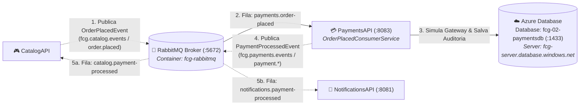

# FIAP Cloud Games - Fase 02 - Microsserviço PaymentsAPI (`fcg-fase-02--payments`)

[](https://dotnet.microsoft.com/)
[](https://azure.microsoft.com/)
[](https://www.rabbitmq.com/)
[](https://www.docker.com/)

> 🎓 **Projeto Acadêmico FIAP**  
> Este microsserviço faz parte do projeto de conclusão de curso da **"Pós-Tech: Arquitetura de Sistemas .NET"** da **FIAP**.  
> O objetivo da solução é projetar e implementar um ecossistema distribuído de nuvem voltado para uma plataforma de jogos digitais (*Cloud Gaming*), aplicando os mais modernos padrões de arquitetura corporativa em **.NET 10**.

---

> 🌐 **Documentação Principal e Orquestração do Ecossistema:**  
> A visão geral de toda a solução distribuída, a topologia de pastas, a arquitetura de redes e o guia para inicialização unificada de todos os microsserviços e bancos de dados estão centralizadas no repositório de **Orquestração**:  
> 👉 **[🚀 Acessar Ponto de Partida & Orquestração (`fcg-fase-02--orchestration`)](https://github.com/idgrego/fcg-fase-02--orchestration)**

---

## 📑 Sumário

- [1. O Microsserviço PaymentsAPI](#1-o-microsserviço-paymentsapi)
  - [1.1. Responsabilidades de Negócio](#11-responsabilidades-de-negócio)
  - [1.2. Regras de Aprovação e Simulação](#12-regras-de-aprovação-e-simulação)
  - [1.3. Diagrama de Integração](#13-diagrama-de-integração)
- [2. Tecnologias & Decisões Arquiteturais](#2-tecnologias--decisões-arquiteturais)
- [3. Como Executar a PaymentsAPI](#3-como-executar-a-paymentsapi)
  - [3.1. Execução Integrada via Docker Compose (Recomendado)](#31-execução-integrada-via-docker-compose-recomendado)
  - [3.2. Execução Individual (.NET CLI & Docker Local)](#32-execução-individual-net-cli--docker-local)
- [4. Endpoints HTTP & Documentação Interativa (Scalar)](#4-endpoints-http--documentação-interativa-scalar)
- [5. Mensageria Assíncrona & Eventos](#5-mensageria-assíncrona--eventos)
  - [5.1. Evento Consumido: `OrderPlacedIntegrationEvent`](#51-evento-consumido-orderplacedintegrationevent)
  - [5.2. Evento Publicado: `PaymentProcessedIntegrationEvent`](#52-evento-publicado-paymentprocessedintegrationevent)
- [6. Testes Unitários](#6-testes-unitários)
- [7. Documentação Técnica Detalhada (`/docs`)](#7-documentação-técnica-detalhada-docs)

---

## 1. O Microsserviço PaymentsAPI

A **PaymentsAPI** é o microsserviço responsável pela simulação de gateway de pagamentos, validação de transações financeiras, persistência de auditoria e publicação de resultados de pagamento para o ecossistema **FIAP Cloud Games**.

### 1.1. Responsabilidades de Negócio
- **Consumo de Pedidos:** Escuta assíncrona da fila `payments.order-placed` no RabbitMQ, originada pela `CatalogAPI`.
- **Gateway Financeiro Simulado:** Processamento síncrono determinístico via `PaymentGatewaySimulator` aplicando limites e regras de risco.
- **Auditoria Financeira:** Registro imutável de todas as transações na tabela `payment_transactions` do banco relacional **`fcg-02-paymentsdb`** (Azure Database).
- **Publicação do Desfecho (Fan-Out):** Publicação de `PaymentProcessedEvent` com as chaves `payment.approved` ou `payment.rejected`, notificando simultaneamente o Catálogo (para liberação do jogo) e as Notificações (para envio do comprovante ou alerta).
- **Consulta de Transações:** Endpoints REST para consulta de histórico de pagamentos por `OrderId`, `UserId` ou `TransactionId`.

### 1.2. Regras de Aprovação e Simulação
O simulador de gateway opera com as seguintes regras de negócio determinísticas:
- **Rejeição Automática:**
  - Valores menores ou iguais a zero (`Amount <= 0`).
  - Valores superiores ao teto de risco de **R$ 5.000,00** (Motivo: *"Valor excede limite máximo de transação"*).
- **Aprovação Automática:** Transações com valores válidos entre R$ 0,01 e R$ 5.000,00.

### 1.3. Diagrama de Integração



---

## 2. Tecnologias & Decisões Arquiteturais

- **Runtime & Plataforma:** .NET 10 (`net10.0`), C# 14, Solution moderna `.slnx`.
- **Clean Architecture:** Separação estrita em 4 camadas (`Domain`, `Application`, `Infrastructure`, `API`).
- **Domain-Driven Design (DDD):** Entidade rica `PaymentTransaction` com métodos de mutação semântica (`Approve`, `Reject`), construtores protegidos e identificadores gerados com **UUIDv7** sequencial (`Guid.CreateVersion7()`).
- **Persistência Relacional com EF Core (Azure Database):** Entity Framework Core com provedor oficial `Microsoft.EntityFrameworkCore.SqlServer`, conectando ao banco dedicado `fcg-02-paymentsdb` no servidor `fcg-server.database.windows.net` com `EnableRetryOnFailure()` e mapeamento via Fluent API com índices de alta performance por `order_id` e `user_id`.
- **Mensageria com RabbitMQ 7.x:** Consumidor reativo com `AsyncEventingBasicConsumer`, QoS com `prefetchCount: 1`, `BasicAckAsync` e publicação assíncrona desacoplada via `RabbitMqEventPublisher`.
- **Minimal APIs Modulares:** Endpoints organizados com `MapGroup` e documentação interativa com **Scalar** (`Scalar.AspNetCore`).

---

## 3. Como Executar a PaymentsAPI

### 3.1. Execução Integrada via Docker Compose (Recomendado)

A forma recomendada de executar a PaymentsAPI é através da orquestração centralizada:

1. Navegue até a pasta de orquestração:
   ```powershell
   cd ../fcg-fase-02--orchestration
   ```

2. Inicialize todos os contêineres:
   ```powershell
   docker compose up -d --build
   ```

3. Verifique os serviços em execução:
   ```powershell
   docker compose ps
   ```

4. Acompanhe os logs da PaymentsAPI:
   ```powershell
   docker compose logs -f payments-api
   ```

---

### 3.2. Execução Individual (.NET CLI & Docker Local)

Caso deseje executar a **PaymentsAPI** diretamente via `.NET CLI`:

1. **Subir o broker RabbitMQ (o banco é hospedado no Azure Database):**
   ```powershell
   # RabbitMQ com Management UI
   docker run -d --name rabbitmq -e RABBITMQ_DEFAULT_USER=guest -e RABBITMQ_DEFAULT_PASS=guest -p 5672:5672 -p 15672:15672 rabbitmq:3-management
   ```

2. **Aplicar as migrações no banco de dados do Azure Database:**
   Na pasta `fcg-fase-02--payments`:
   ```powershell
   dotnet ef database update --project src/FCG02.PaymentsAPI.Infrastructure --startup-project src/FCG02.PaymentsAPI.API
   ```

3. **Executar a API via .NET CLI:**
   ```powershell
   dotnet run --project src/FCG02.PaymentsAPI.API
   ```

A API estará acessível em `http://localhost:5000` (ou na porta informada no terminal).

---

## 4. Endpoints HTTP & Documentação Interativa (Scalar)

Com o serviço em execução, acesse a interface interativa do **Scalar**:

👉 **URL do Scalar:** `http://localhost:8083/scalar/v1` (no Docker) ou `http://localhost:PORTA/scalar/v1` (local).

### Principais Endpoints:

| Método | Rota | Descrição |
|---|---|---|
| `GET` | `/api/v1/payments/{orderId}` | Consulta uma transação financeira pelo ID do Pedido |
| `GET` | `/api/v1/payments/transaction/{id}` | Consulta detalhes de uma transação pelo seu identificador primário |
| `GET` | `/api/v1/payments/user/{userId}` | Retorna todo o histórico de transações de um jogador |
| `POST` | `/api/v1/payments/simulate` | Endpoint para simulação direta de pagamento sem passar pelo broker |
| `GET` | `/health` | Endpoint de verificação de integridade do serviço |

---

## 5. Mensageria Assíncrona & Eventos

### 5.1. Evento Consumido: `OrderPlacedIntegrationEvent`
- **Exchange:** `fcg.catalog.events`
- **Fila:** `payments.order-placed`
- **Routing Key:** `order.placed`

```json
{
  "orderId": "770e8400-e29b-41d4-a716-446655440111",
  "userId": "550e8400-e29b-41d4-a716-446655440000",
  "gameId": "67210b3a4e9b8c0012e45678",
  "price": 199.90,
  "createdAt": "2026-10-29T10:05:00Z"
}
```

### 5.2. Evento Publicado: `PaymentProcessedIntegrationEvent`
- **Exchange:** `fcg.payments.events` (Topic)
- **Routing Keys:** `payment.approved` ou `payment.rejected`
- **Consumidores:** `CatalogAPI` (fila `catalog.payment-processed`) e `NotificationsAPI` (fila `notifications.payment-processed`).

```json
{
  "paymentId": "990e8400-e29b-41d4-a716-446655440222",
  "orderId": "770e8400-e29b-41d4-a716-446655440111",
  "userId": "550e8400-e29b-41d4-a716-446655440000",
  "gameId": "67210b3a4e9b8c0012e45678",
  "amount": 199.90,
  "status": "Approved",
  "reason": "Transação autorizada com sucesso pelo gateway simulado.",
  "processedAt": "2026-10-29T10:05:01Z"
}
```

---

## 6. Testes Unitários

A **PaymentsAPI** possui suíte automatizada desenvolvida com **xUnit**, **Moq** e **FluentAssertions**:
- **Domínio:** Mutações de estado da entidade `PaymentTransaction` (transições de `Pending` para `Approved` ou `Rejected`, bloqueio de transições inválidas e validações monetárias).
- **Aplicação:** Casos de uso do `PaymentService` e do simulador financeiro com isolamento completo de banco de dados e mensageria.

Para executar todos os testes da solução:

```powershell
dotnet test tests/FCG02.PaymentsAPI.UnitTests/FCG02.PaymentsAPI.UnitTests.csproj --logger "console;verbosity=detailed"
```

---

## 7. Documentação Técnica Detalhada (`/docs`)

Para um aprofundamento específico em cada camada arquitetural da PaymentsAPI, consulte os documentos na pasta [`/docs`](docs/index.md):

- **[📑 Índice da Documentação Técnica](docs/index.md)**
- **[🏛️ Arquitetura e Decisões de Design](docs/architecture.md)**
- **[🧩 Camada de Domínio & Transações Financeiras](docs/domain.md)**
- **[⚙️ Camada de Aplicação, DTOs e Simulador de Gateway](docs/application.md)**
- **[☁️ Camada de Infraestrutura, EF Core e RabbitMQ](docs/infrastructure.md)**
- **[🚀 Camada de Apresentação, Minimal APIs e Scalar](docs/api.md)**
- **[🧪 Suíte de Testes Unitários](docs/tests.md)**
- **[🐳 Containerização e Docker Multi-stage](docs/docker.md)**
- **[☸️ Orquestração com Kubernetes](docs/k8s.md)**
