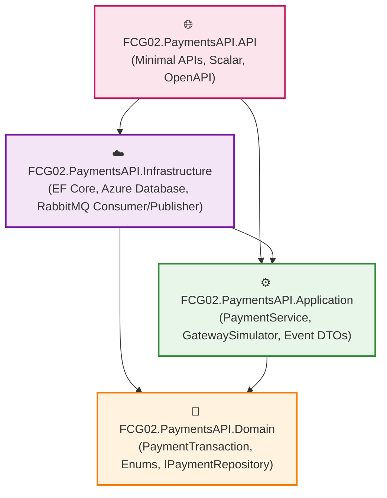
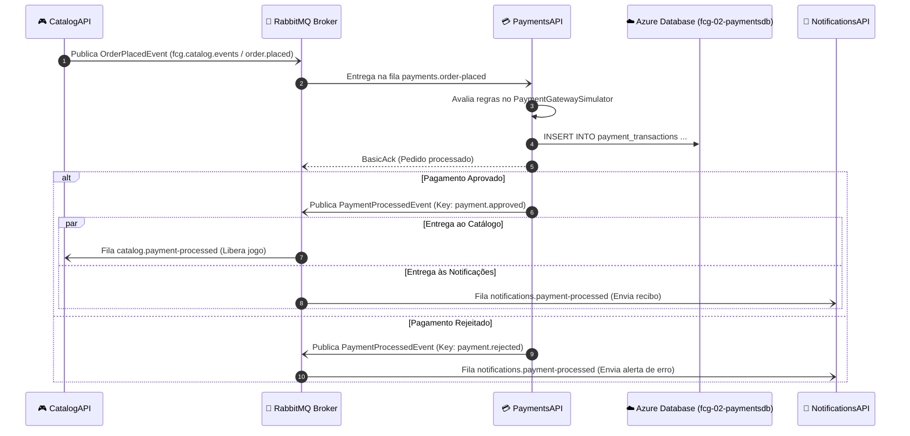

# PaymentsAPI - Arquitetura e Decisões de Design

Este documento apresenta a arquitetura da **PaymentsAPI** (`fcg-fase-02--payments`), detalhando a aplicação da **Clean Architecture**, a estratégia de persistência relacional com o **Azure Database** e a orquestração assíncrona orientada a eventos via **RabbitMQ**.

---

## 📑 Sumário

- [1. Visão Geral da Clean Architecture](#1-visão-geral-da-clean-architecture)
- [2. Estrutura de Camadas e Dependências](#2-estrutura-de-camadas-e-dependências)
- [3. Persistência Relacional: Azure Database](#3-persistência-relacional-azure-database)
- [4. Fluxo Orientado a Eventos e Padrão Fan-Out](#4-fluxo-orientado-a-eventos-e-padrão-fan-out)
- [5. Resiliência e Idempotência](#5-resiliência-e-idempotência)
- [6. Navegação](#6-navegação)

---

## 1. Visão Geral da Clean Architecture

A **PaymentsAPI** adota uma Clean Architecture estrita para manter as regras de validação financeira e a máquina de estados das transações totalmente desacopladas do banco de dados relacional e do message broker.

---

## 2. Estrutura de Camadas e Dependências

1. **`Domain` (Regras Financeiras):**
   - Modela a entidade `PaymentTransaction` com encapsulamento estrito e máquina de estados (`Pending` $\rightarrow$ `Approved` ou `Rejected`).
   - Define a interface `IPaymentRepository` e os enums `PaymentStatus` e `PaymentMethod`.
2. **`Application` (Casos de Uso e Simulação):**
   - Implementa o `PaymentGatewaySimulator` aplicando regras de limite de risco.
   - Orquestra a execução via `PaymentService` e despacha eventos assíncronos via `IEventPublisher`.
3. **`Infrastructure` (Banco de Dados e Broker):**
   - Mapeia a tabela `payment_transactions` via Fluent API do EF Core no Azure Database (`fcg-02-paymentsdb`).
   - Executa o consumidor assíncrono em segundo plano (`OrderPlacedConsumerService`) escutando na fila `payments.order-placed`.
4. **`API` (Apresentação e Consultas):**
   - Fornece endpoints de consulta de pagamentos e histórico de auditoria via Minimal APIs com documentação Scalar.

---

## 3. Persistência Relacional: Azure Database

Para o microsserviço de pagamentos, utiliza-se o **Azure Database** (servidor `fcg-server.database.windows.net`, banco dedicado `fcg-02-paymentsdb`):
- **Consistência ACID:** Transações financeiras e registros de auditoria exigem consistência transacional estrita (gravação atômica de status, carimbos de data/hora e justificativas de recusa).
- **Integridade Referencial e Tipagem Forte:** Tipos nativos para identificadores UNIQUEIDENTIFIER (UUID) e valores monetários de precisão arbitrária (`decimal(18,2)`).
- **Resiliência Cloud-Native:** Política de reconexão automática com `EnableRetryOnFailure()` contra falhas transitórias de conexão na nuvem.
- **Índices de Alta Performance:** Criação de índices dedicados por `order_id` e `user_id` para agilizar consultas imediatas de histórico.

---

## 4. Fluxo Orientado a Eventos e Padrão Fan-Out

---

## 5. Resiliência e Idempotência

1. **Garantia At-least-once:** O consumidor utiliza confirmação manual `BasicAckAsync`. A mensagem só é confirmada após a transação ser gravada com sucesso no Azure Database.
2. **Índice Único por Pedido:** O banco rejeita transações duplicadas com o mesmo `order_id`, protegendo contra reprocessamento acidental de pedidos já finalizados.
3. **Desacoplamento por Topic Exchange:** A PaymentsAPI desconhece quem são os interessados no resultado do pagamento; ela publica em `fcg.payments.events` e o broker roteia seletivamente.

---

## 6. Navegação

- ⬅️ **[Voltar para o Índice da Documentação](index.md)**
- ➡️ **[Avançar para a Camada de Domínio (`domain.md`)](domain.md)**
