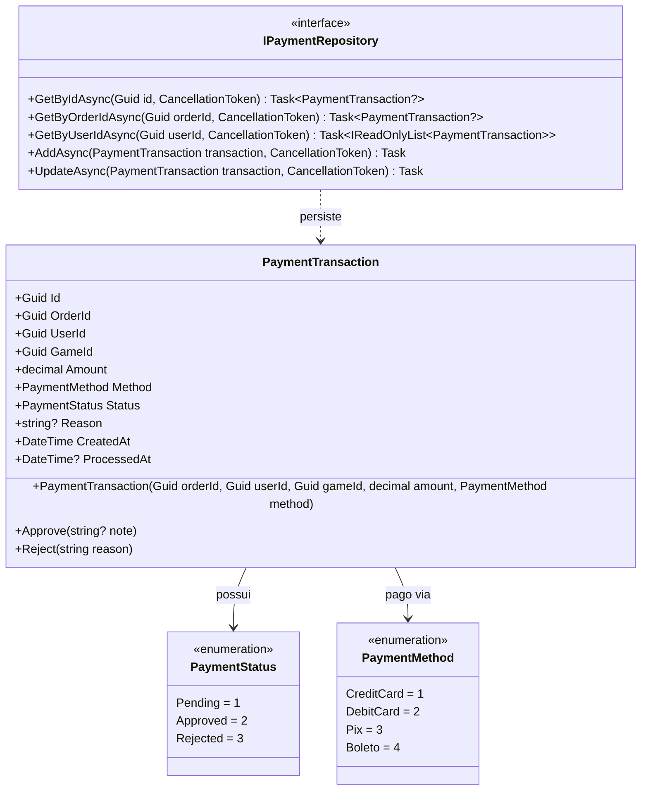
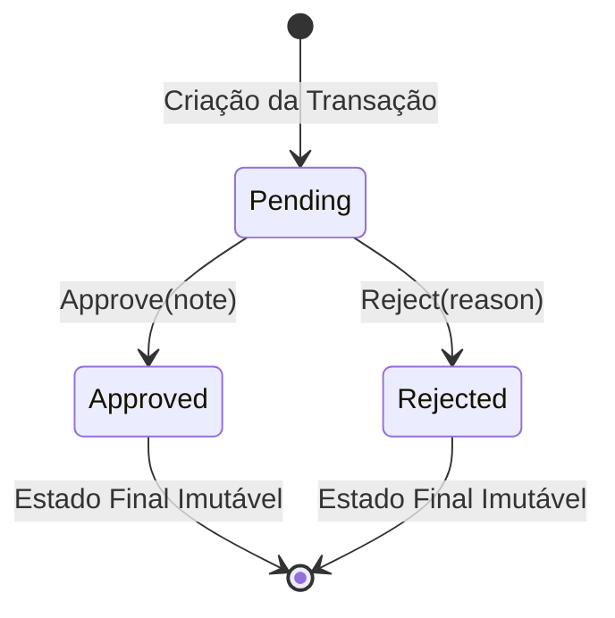

# PaymentsAPI - Documentação Técnica: Camada de Domínio

A camada **`FCG02.PaymentsAPI.Domain`** encapsula as regras financeiras e a integridade de transações de pagamento da plataforma **FIAP Cloud Games**, de forma 100% agnóstica a bancos de dados e mensageria.

---

## 📑 Sumário

- [1. Visão Geral e Diagrama de Classes](#1-visão-geral-e-diagrama-de-classes)
- [2. Entidade de Domínio: `PaymentTransaction`](#2-entidade-de-domínio-paymenttransaction)
  - [2.1. Princípios de Encapsulamento e Máquina de Estados](#21-princípios-de-encapsulamento-e-máquina-de-estados)
  - [2.2. Geração de Identificadores Sequenciais com UUIDv7](#22-geração-de-identificadores-sequenciais-com-uuidv7)
- [3. Enumerações: `PaymentStatus` e `PaymentMethod`](#3-enumerações-paymentstatus-e-paymentmethod)
- [4. Interface de Repositório: `IPaymentRepository`](#4-interface-de-repositório-ipaymentrepository)
- [5. Navegação](#5-navegação)

---

## 1. Visão Geral e Diagrama de Classes



---

## 2. Entidade de Domínio: `PaymentTransaction`

Localização: `src/FCG02.PaymentsAPI.Domain/Entities/PaymentTransaction.cs`

### 2.1. Princípios de Encapsulamento e Máquina de Estados
A entidade `PaymentTransaction` impede alterações diretas de propriedades através de `private set`. Ela implementa uma **máquina de estados estrita**:



- **Invariante de Criação:** Valida obrigatoriedade de `OrderId`, `UserId`, `GameId` e impede valores negativos (`Amount >= 0`). Toda transação nasce obrigatoriamente com status `PaymentStatus.Pending`.
- **Aprovação (`Approve`):** Só pode ser executada se a transação estiver em `Pending`. Atualiza o status para `Approved`, carimba a data de conclusão `ProcessedAt = DateTime.UtcNow` e registra uma nota explicativa.
- **Rejeição (`Reject`):** Exige um motivo obrigatório (`reason` não-vazio). Transita para `Rejected` e registra `ProcessedAt`.
- **Bloqueio de Transições Inválidas:** Tentar aprovar ou rejeitar uma transação que já foi finalizada resulta em `InvalidOperationException`.

### 2.2. Geração de Identificadores Sequenciais com UUIDv7
- A chave primária é gerada com **`Guid.CreateVersion7()`** (nativo do .NET 9/10).
- Como o UUIDv7 é ordenado cronologicamente, ele otimiza drasticamente os índices B-Tree do Azure Database (SQL Server), evitando fragmentação de páginas de dados no armazenamento sob alto volume de transações.

---

## 3. Enumerações: `PaymentStatus` e `PaymentMethod`

Localização: `src/FCG02.PaymentsAPI.Domain/Enums/`

- **`PaymentStatus`:**
  - `Pending = 1`: Aguardando processamento pelo gateway.
  - `Approved = 2`: Pagamento autorizado e concluído.
  - `Rejected = 3`: Pagamento recusado pelo gateway financeiro.
- **`PaymentMethod`:**
  - `CreditCard = 1`, `DebitCard = 2`, `Pix = 3`, `Boleto = 4`.

---

## 4. Interface de Repositório: `IPaymentRepository`

Localização: `src/FCG02.PaymentsAPI.Domain/Interfaces/IPaymentRepository.cs`

Define o contrato abstrato de persistência para recuperação e auditoria de pagamentos:
```csharp
public interface IPaymentRepository
{
    Task<PaymentTransaction?> GetByIdAsync(Guid id, CancellationToken cancellationToken = default);
    Task<PaymentTransaction?> GetByOrderIdAsync(Guid orderId, CancellationToken cancellationToken = default);
    Task<IReadOnlyList<PaymentTransaction>> GetByUserIdAsync(Guid userId, CancellationToken cancellationToken = default);
    Task AddAsync(PaymentTransaction transaction, CancellationToken cancellationToken = default);
    Task UpdateAsync(PaymentTransaction transaction, CancellationToken cancellationToken = default);
}
```

---

## 5. Navegação

- ⬅️ **[Voltar para a Arquitetura (`architecture.md`)](architecture.md)**
- ➡️ **[Avançar para a Camada de Aplicação (`application.md`)](application.md)**
