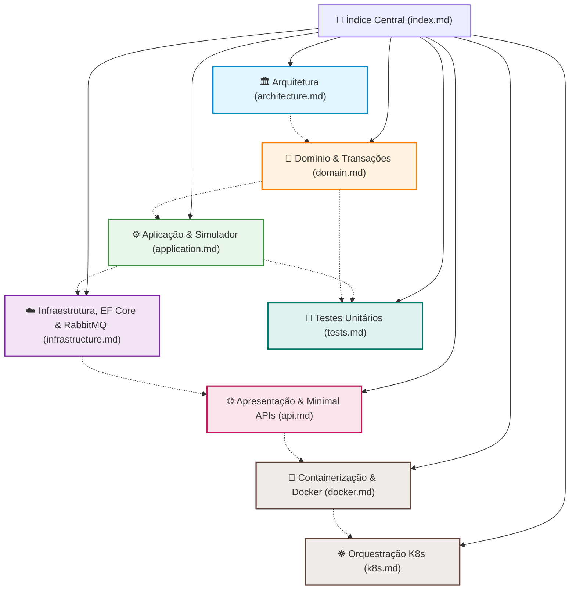

# PaymentsAPI - Índice da Documentação Técnica

Bem-vindo à documentação técnica oficial da **PaymentsAPI** (`fcg-fase-02--payments`), microsserviço responsável pela simulação de gateway de pagamentos, validação de transações, auditoria financeira e publicação de eventos de desfecho na plataforma **FIAP Cloud Games**.

---

## 🗺️ Mapa de Navegação da Documentação

---

## 📚 Módulos de Documentação

### 1. [🏛️ Arquitetura da Solução (`architecture.md`)](architecture.md)
Visão geral da Clean Architecture, segregação de banco com Azure Database isolado (`fcg-02-paymentsdb`), padrão de mensageria assíncrona com RabbitMQ e o fluxo Fan-Out de resultados financeiros.

### 2. [🧩 Camada de Domínio (`domain.md`)](domain.md)
Detalhamento da entidade rica `PaymentTransaction`, geração de UUIDv7 sequencial, enums de status (`Pending`, `Approved`, `Rejected`) e métodos semânticos de mutação de estado.

### 3. [⚙️ Camada de Aplicação (`application.md`)](application.md)
Detalhamento dos casos de uso e DTOs:
- Lógica determinística do `PaymentGatewaySimulator` (limites e regras de recusa).
- Orquestração do `PaymentService`.
- Contratos de eventos: `OrderPlacedIntegrationEvent` e `PaymentProcessedIntegrationEvent`.

### 4. [☁️ Camada de Infraestrutura (`infrastructure.md`)](infrastructure.md)
Detalhamento técnico da persistência relacional e mensageria:
- Configuração do Entity Framework Core com Azure Database (`PaymentsDbContext`, `Microsoft.EntityFrameworkCore.SqlServer` com `EnableRetryOnFailure()`).
- Migrações, Fluent API e índices de alta performance por `order_id` e `user_id`.
- Publicador com `RabbitMqEventPublisher`.
- Consumo em segundo plano com `OrderPlacedConsumerService` (`BackgroundService`).

### 5. [🚀 Camada de Apresentação (`api.md`)](api.md)
Endpoints HTTP, consultas de auditoria e documentação interativa:
- Minimal APIs agrupadas via `PaymentEndpoints.cs`.
- Consultas por `orderId`, `id` e histórico por `userId`.
- Documentação OpenAPI com **Scalar** (`/scalar/v1`).
- Pipeline e startup no `Program.cs`.

### 6. [🧪 Suíte de Testes Unitários (`tests.md`)](tests.md)
Testes automatizados com xUnit, Moq e FluentAssertions:
- Testes de domínio validando transições de estado e invariantes.
- Testes de aplicação com dublês de repositório e broker.

### 7. [🐳 Containerização com Docker (`docker.md`)](docker.md)
Empacotamento e segurança para ambientes de produção:
- Multi-stage build com .NET 10.
- Execução não-root segura com `USER app`.
- Integração ao Docker Compose e comandos para execução de migrações em container.

### 8. [☸️ Orquestração com Kubernetes (`k8s.md`)](k8s.md)
Arquitetura de implantação em clusters Kubernetes:
- Manifestos na pasta `/k8s` (`ConfigMap`, `Secret` em Base64, `Deployment`, `Service` ClusterIP).
- Réplicas de Pods (2) com consumidor de pedidos (`OrderPlacedConsumerService`) ativo em alta disponibilidade.
- Sondas de integridade (`readinessProbe` e `livenessProbe`) integradas ao `/health`.
- Limites e requisições de recursos computacionais (`resources: requests/limits`).
